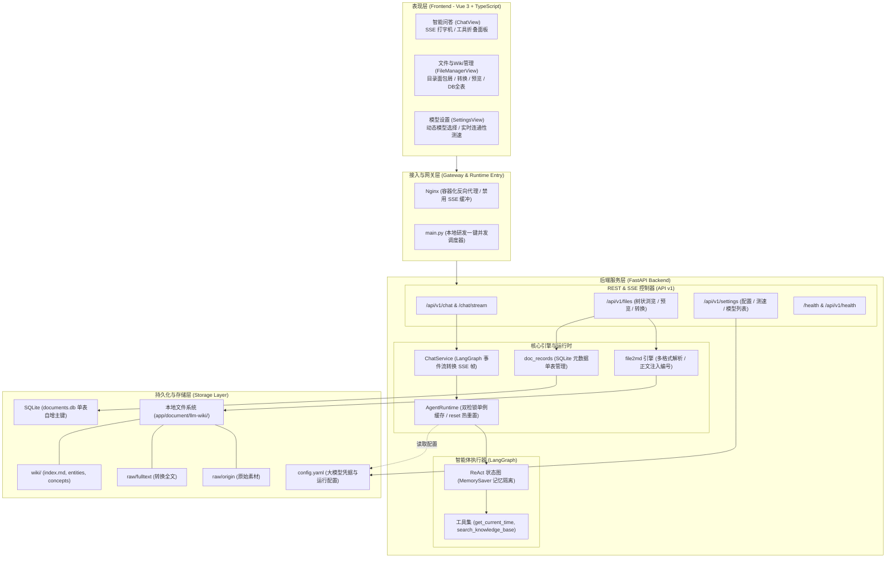
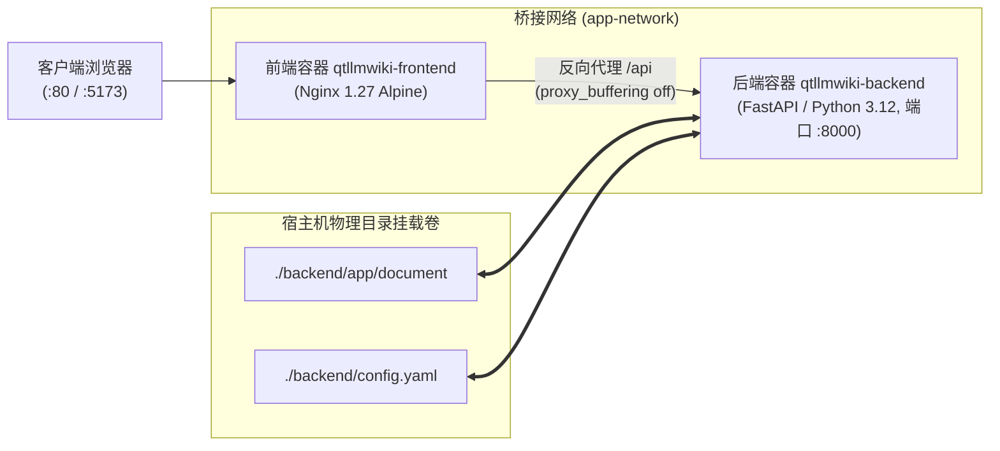
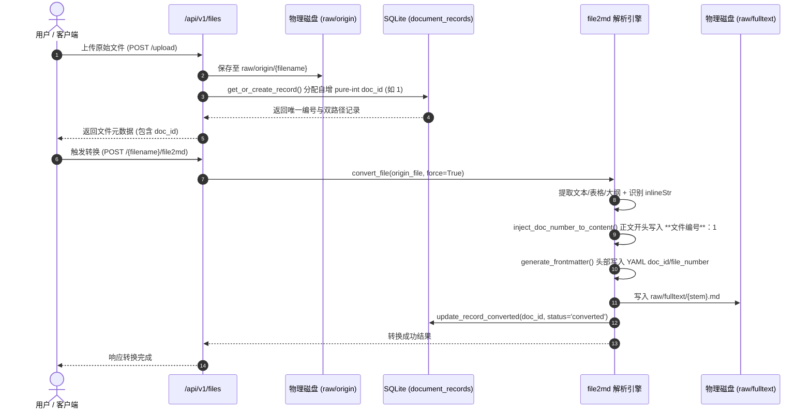
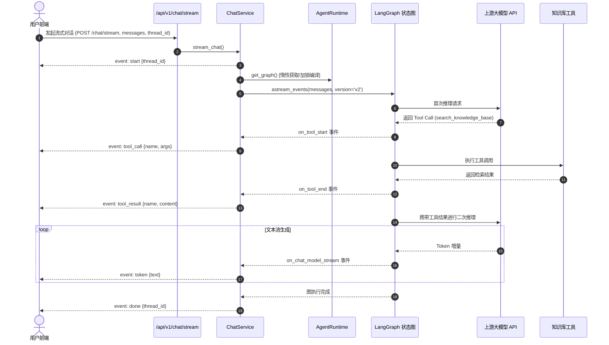

# qt-llmwiki 概要设计说明书（总体设计）

**文档版本**：v1.0.0  
**编写日期**：2026-10-10  
**文档状态**：正式发布（持续维护）  
**架构师**：System Architecture Team  

---

## 1. 系统概述与建设目标

### 1.1 项目背景
`qt-llmwiki` 是一个面向企业知识沉淀与智能问答的系统。传统检索增强生成（Naive RAG）通常采用固定分块（Chunking）加向量数据库检索，存在上下文碎片化、跨文档逻辑关系丢失、原始结构信息破损等痛点。本项目遵循 **LLM-Wiki** 体系架构，将非结构化原始资产结构化提取为高保真 Markdown，并统一分配永久不可变的自增纯数字文件编号，构建由 AI 与人工协同维护的分层维基百科知识库。

### 1.2 建设目标
1. **统一标识与双路径追踪**：建立全局纯数字递增标识（`doc_id` 从 1 开始），实现原始文件与转换全文的终身绑定；
2. **多格式高保真无依赖解析（`file2md`）**：原生支持 Word (`.docx`)、Excel (`.xlsx`)、PPT (`.pptx`)、PDF、CSV、JSON 等格式结构化转 Markdown，支持复杂表格与内联字符；
3. **分层知识库组织体系**：建立 `raw/origin`（素材池）$\rightarrow$ `raw/fulltext`（全文缓存）$\rightarrow$ `wiki/`（主题百科）的三层递进结构；
4. **智能体驱动与状态透明**：基于 LangGraph 构建 ReAct 模式智能体，通过 SSE 提供打字机流式响应，透明展示工具调用过程；
5. **双轨敏捷部署与热维护**：支持 `main.py` 一键本地开发和 `docker-compose` 生产容器化编排，支持模型配置热更新。

---

## 2. 系统总体架构设计

### 2.1 架构分层图

### 2.2 模块划分与职责边界

| 模块名称 | 职责定位 | 核心文件位置 |
| :--- | :--- | :--- |
| **智能问答模块 (Chat)** | 提供对话交互、会话记忆隔离、LangGraph 事件流与 SSE 协议转换、工具执行追踪 | `backend/app/api/v1/chat.py` `backend/app/services/chat_service.py` |
| **智能体运行时 (Agent Runtime)** | 大模型实例构建、ReAct 状态机编排、双检锁单例缓存、配置热更新重置 | `backend/app/agents/` |
| **文件与知识库模块 (Files)** | 知识库目录安全树状浏览、文件上传/下载/删除、防路径越界校验、全文预览 | `backend/app/api/v1/files.py` |
| **file2md 结构化转换引擎** | Office/PDF/文本结构化转 Markdown、YAML Frontmatter 注入、正文注入文件编号 | `backend/app/services/file2md.py` |
| **文档数据库映射模块 (DB)** | SQLite 单表映射管理、自增纯数字编号分配与不可变性保障、磁盘数据同步一致性 | `backend/app/db/doc_records.py` |
| **系统配置模块 (Settings)** | 读写 `config.yaml`、内存设置同步、大模型端点在线连通性测试与模型发现 | `backend/app/api/v1/settings.py` `backend/app/core/yaml_config.py` |

---

## 3. 技术栈选型矩阵

| 分层 | 选型技术 | 版本/规范 | 选型理由 |
| :--- | :--- | :--- | :--- |
| **后端语言与框架** | Python + FastAPI | Python 3.12+ / FastAPI 0.115+ | 原生全异步支持、Pydantic 自动化数据校验、内置 OpenAPI 文档生成 |
| **智能体工作流** | LangGraph + LangChain | LangGraph 0.2+ | 支持循环图状态机、ReAct 模式、短时记忆隔离与事件流细粒度监控 |
| **元数据存储** | SQLite 3 | SQLite 3 (WAL 模式) | 零运维依赖、轻量单文件、原生支持自增主键、通过 Docker 卷无缝持久化 |
| **配置存储** | YAML / PyYAML | YAML 1.2 | 人类友好易读写、支持根目录软链接与双向实时映射 |
| **前端框架** | Vue 3 + TypeScript | Vue 3.5+ / TS 5.6+ | 组合式 API (`<script setup>`)，强类型保障，高性能组件渲染 |
| **前端工程构建** | Vite | Vite 5.4+ | 极速冷启动、HMR 毫秒级热更新、生产打包优化 |
| **网关与容器化** | Docker + Nginx | Compose v2 / Nginx Alpine | 标准容器化封装，内置反向代理配置及针对 SSE 流的缓冲禁用规则 |

---

## 4. 部署架构设计

### 4.1 容器化拓扑图（Docker Compose）

### 4.2 本地研发一键启动架构（`main.py`）
针对本地开发环境，系统在根目录下设计了统一调度器 [`main.py`](file:///Users/autumn/Desktop/qt-llmwiki/main.py)：
1. 自动探测解释器：优先探测 `backend/.venv` 虚拟环境，未探测到时降级为系统解释器；
2. 并行调度：并发拉起 `uvicorn app.main:app --reload`（8000 端口）和 Vite 开发服务器（5173 端口）；
3. 状态探针检测：主动轮询探活接口 `http://127.0.0.1:8000/health`，就绪后自动唤起系统浏览器；
4. 优雅关停：统一捕获 `SIGINT` / `SIGTERM` 信号，确保子进程完整回收，杜绝孤儿进程占用端口。

---

## 5. 核心数据流设计

### 5.1 知识文件入库与 file2md 转换流

### 5.2 问答与工具调用 SSE 交互流

---

## 6. 第三方系统集成与外部依赖

1. **大模型兼容网关**：
   - 遵循 OpenAI Chat Completions 规范（支持 OpenAI 官方、DeepSeek、Ollama、OneAPI、vLLM、LMStudio 等）；
   - 支持动态端点探测：请求 `{base_url}/models` 动态枚举开放模型。
2. **操作系统与标准库**：
   - Office 文档解析原生基于 Python 标准库 `zipfile` 与 `xml.etree.ElementTree`，零重型第三方依赖包侵入；
   - 路径安全依赖标准库 `posixpath` 与 `pathlib.Path` 实现跨平台路径规范化。
