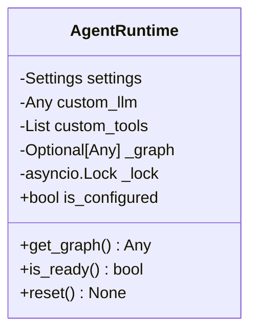
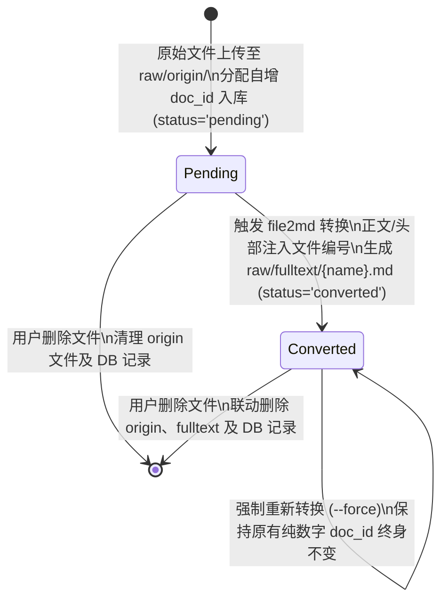
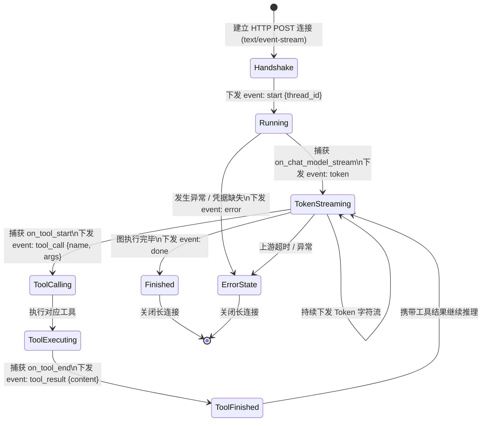
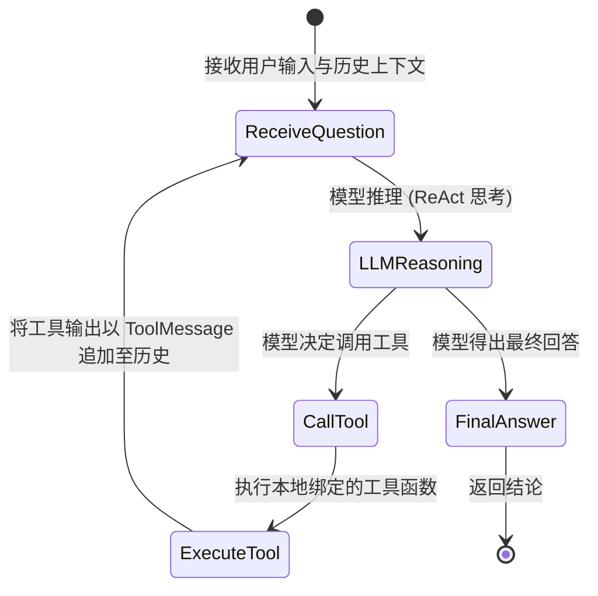

# qt-llmwiki 详细设计说明书（Detailed Design）

**文档版本**：v1.0.0  
**编写日期**：2026-10-10  
**文档状态**：正式发布（持续维护）  
**架构师**：System Architecture Team  

---

## 1. 核心模块类与对象设计

### 1.1 AgentRuntime 运行时管理类
- **文件位置**：[`backend/app/agents/runtime.py`](file:///Users/autumn/Desktop/qt-llmwiki/backend/app/agents/runtime.py)
- **设计模式**：单例模式（Singleton）+ 惰性初始化（Lazy Initialization）+ 双检锁（Double-Checked Locking）



- **类成员与方法说明**：
  - `is_configured`: 只读属性，校验系统当前是否已经具备可运行的大模型 API 凭据。
  - `async def get_graph(self) -> Any`: 核心入口。线程/协程安全。若 `_graph` 为空，加 `asyncio.Lock` 锁后二次检查，调用 `create_chat_model()` 和 `build_agent_graph()` 编译 ReAct 状态图，并缓存到 `_graph`。
  - `def reset(self) -> None`: 重置内部缓存 `self._graph = None`。在用户于「设置」页面更新大模型凭据或模型名称后被调用，确保下次请求即刻加载新配置。

### 1.2 ChatService 对话编排服务类
- **文件位置**：[`backend/app/services/chat_service.py`](file:///Users/autumn/Desktop/qt-llmwiki/backend/app/services/chat_service.py)
- **职责**：屏蔽底层 LangGraph 复杂度，向 API 层统一提供同步对话与 SSE 流式事件发生器。

- **核心方法设计**：
  - `async def chat(self, messages: List[ChatMessage], thread_id: Optional[str] = None) -> ChatResponse`:
    - 若未指定 `thread_id` 则生成 UUID4 字符串；
    - 计算递归深度 `recursion_limit = 2 * AGENT_MAX_ITERATIONS + 1`；
    - 执行 `graph.ainvoke()` 并提取最终回复文本及耗时。
  - `async def stream_chat(self, messages: List[ChatMessage], thread_id: Optional[str] = None) -> AsyncIterator[str]`:
    - 首先 `yield format_sse("start", {"thread_id": thread_id})`；
    - 调用 `graph.astream_events(version="v2")`；
    - 捕获 `on_chat_model_stream` 事件并格式化为 `event: token`；
    - 捕获 `on_tool_start` 和 `on_tool_end` 事件并格式化为 `event: tool_call` 与 `event: tool_result`；
    - 执行完毕后推送 `event: done`，异常时推送 `event: error`。

---

## 2. 核心算法与关键逻辑实现

### 2.1 file2md OpenXML 高保真结构化解析算法
- **源码位置**：[`backend/app/services/file2md.py`](file:///Users/autumn/Desktop/qt-llmwiki/backend/app/services/file2md.py)

#### 2.1.1 单元格坐标转二维网格列索引算法
OpenXML 中空单元格不输出 `<c>` 标签，必须解析坐标字符串（如 `H5`、`AA12`）：

```python
def col_letter_to_index(col_str: str) -> int:
    """将 Excel 列字母（如 A, Z, AA）转换为 0-based 列索引"""
    idx = 0
    for char in col_str.upper():
        if "A" <= char <= "Z":
            idx = idx * 26 + (ord(char) - ord("A") + 1)
    return idx - 1
```

#### 2.1.2 单元格类型全格式抽取逻辑
针对不同单元格属性 `t` 分支处理：
1. `c_type == "inlineStr"`：解析 `<is>` 及其子节点 `<t>` 文本（包含富文本 `<r><t>`），彻底解决数据丢失问题；
2. `c_type == "s"`：读取 `<v>` 内的数字索引，在预加载的 `shared_strings` 数组中查找原文字符串；
3. `c_type == "b"`：值为 `"1"` 转换为 `"TRUE"`，值为 `"0"` 转换为 `"FALSE"`；
4. 其它/数值/公式：读取 `<v>` 缓存结果，或提取 `<t>` 文本；
5. 单元格清洗：将单元格内部换行符 `\r\n` / `\n` 替换为 `<br>`，管道符 `|` 转义为 `\\|`。

#### 2.1.3 自适应多表格与横幅标题拆分算法
一个 Sheet 内部可能包含顶部标题横幅、主数据表与底部统计表。算法通过行非空单元格分布进行智能切分：
1. 遍历连续非空行；
2. 若整行仅有 1 个非空单元格且位于靠前列，切分为 `heading` 元素，渲染为 `### {text}`；
3. 其余连续行划入 `table` 元素，根据子表格实际最大列数动态裁剪右侧空列，输出对齐的 Markdown 表格语法。

### 2.2 正文文件编号注入防重算法
- **函数名**：[`inject_doc_number_to_content()`](file:///Users/autumn/Desktop/qt-llmwiki/backend/app/services/file2md.py#L345-L365)
- **算法逻辑**：
  ```python
  def inject_doc_number_to_content(content: str, doc_id: Optional[Union[int, str]]) -> str:
      if doc_id is None:
          return content
      doc_str = str(doc_id).strip()
      prefix = f"**文件编号**：{doc_str}\n\n"
      
      stripped = content.strip()
      # 防重校验：若正文开头已存在相同编号，直接返回不重复追加
      if (
          stripped.startswith(f"**文件编号**：{doc_str}")
          or stripped.startswith(f"文件编号：{doc_str}")
          or stripped.startswith(f"**文件编号**:{doc_str}")
          or stripped.startswith(f"文件编号:{doc_str}")
      ):
          return content
          
      return f"{prefix}{content.lstrip()}" if content else prefix.rstrip()
  ```

### 2.3 知识库目录安全防越界校验算法
- **源码位置**：[`backend/app/api/v1/files.py`](file:///Users/autumn/Desktop/qt-llmwiki/backend/app/api/v1/files.py#L65-L95)
- **安全约束**：系统所有针对 `llm-wiki` 的相对路径浏览、读取、写入与删除必须限制在根目录以内，防御路径遍历攻击（Path Traversal）：

```python
def resolve_wiki_path(rel_path: str = "") -> Path:
    normalized = normalize_rel_path(rel_path)
    target = (LLM_WIKI_ROOT / normalized).resolve()
    # 严格校验解析后的真实物理路径是否以 LLM_WIKI_ROOT 开头
    try:
        target.relative_to(LLM_WIKI_ROOT)
    except ValueError:
        raise HTTPException(
            status_code=status.HTTP_400_BAD_REQUEST,
            detail="非法路径：禁止超出知识库根目录",
        )
    return target
```

### 2.4 上游大模型模型列表提取与网络诊断算法
- **函数名**：[`extract_model_ids()`](file:///Users/autumn/Desktop/qt-llmwiki/backend/app/api/v1/settings.py#L39-L60)
- **兼容策略**：各大供应商对 `/models` 接口返回的 Schema 存在差异：
  - OpenAI / DeepSeek / OneAPI: `{"data": [{"id": "gpt-4o"}, ...]}`
  - Ollama / 本地网关: `{"models": [{"name": "llama3:latest"}, ...]}`
  - 简化网关: `["model-a", "model-b"]`
  算法自适应探测字典键 `data`、`models`，从对象中提取 `id`、`name` 或 `model` 字段，去重并保留原始顺序。

---

## 3. 核心业务状态机设计

### 3.1 文档全生命周期状态机



### 3.2 SSE 流式对话长连接交互状态机



### 3.3 智能体 ReAct 思考与工具调度状态机


