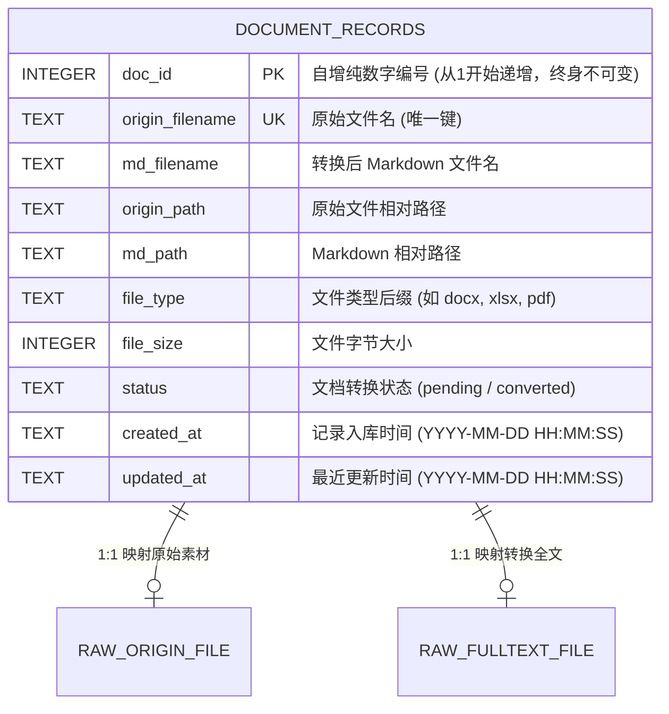

# qt-llmwiki 数据库设计文档（DBD）

**文档版本**：v1.0.0  
**编写日期**：2026-10-10  
**文档状态**：正式发布（持续维护）  
**架构师**：System Architecture Team  

---

## 1. 数据库选型与物理架构

### 1.1 存储选型
- **数据库引擎**：**SQLite 3**
- **物理存储路径**：`backend/app/document/llm-wiki/documents.db`（支持环境变量 `DOC_DB_PATH` 覆盖重定向）
- **日志与并发模式**：
  - `PRAGMA journal_mode = WAL;`（预写日志模式，读写并发互不阻塞）
  - `PRAGMA synchronous = NORMAL;`（平衡安全性与极速磁盘写入）
  - `timeout = 15.0;`（超时重试锁定机制）

### 1.2 单表设计理念
系统元数据采用高度内聚的单表架构设计（`document_records`）。
1. **零外部运维开销**：不依赖 MySQL / PostgreSQL 等重型独立数据库容器，随应用及宿主机目录一键拉起和备份；
2. **纯数字主键唯一性**：利用 SQLite 原生自增主键保证纯数字递增（从 1 开始）；
3. **强一致性双路径绑定**：单表原子化记录原始素材路径与转换后全文路径，杜绝两阶段提交与多表联查的同步风险。

---

## 2. 概念模型与 ER 图设计



---

## 3. 逻辑与物理表结构设计

### 3.1 表名：`document_records`（文档映射记录表）

| 字段名 | 物理类型 | 允许空 | 默认值 | 约束说明 | 业务含义 |
| :--- | :--- | :---: | :---: | :--- | :--- |
| **`doc_id`** | `INTEGER` | 否 | `AUTOINCREMENT` | **PK (主键)** | **文档唯一编号**，纯正整数，从 1 开始单调递增，分配后永久不允许修改 |
| **`origin_filename`** | `TEXT` | 否 | 无 | **UNIQUE** | 原始文件名（包含后缀），在素材池中全局唯一 |
| **`md_filename`** | `TEXT` | 是 | `NULL` | INDEX | 转换出的 Markdown 全文文件名（通常为 `{stem}.md`） |
| **`origin_path`** | `TEXT` | 否 | 无 | 无 | 原始素材文件相对路径（如 `raw/origin/岗位说明.docx`） |
| **`md_path`** | `TEXT` | 是 | `NULL` | 无 | 转换后 Markdown 相对路径（如 `raw/fulltext/岗位说明.md`） |
| **`file_type`** | `TEXT` | 是 | `NULL` | 无 | 文件格式扩展名（如 `docx`、`xlsx`、`pdf`、`txt`） |
| **`file_size`** | `INTEGER` | 否 | `0` | 无 | 文件大小（字节数 Bytes） |
| **`status`** | `TEXT` | 否 | `'pending'` | INDEX | 文档状态（`pending`: 待转换；`converted`: 已转换） |
| **`created_at`** | `TEXT` | 否 | 无 | 无 | 首次录入创建时间（标准格式 `YYYY-MM-DD HH:MM:SS`） |
| **`updated_at`** | `TEXT` | 否 | 无 | 无 | 元数据或转换状态最后变更时间 |

### 3.2 DDL 创建语句
```sql
CREATE TABLE IF NOT EXISTS document_records (
    doc_id INTEGER PRIMARY KEY AUTOINCREMENT,
    origin_filename TEXT NOT NULL UNIQUE,
    md_filename TEXT,
    origin_path TEXT NOT NULL,
    md_path TEXT,
    file_type TEXT,
    file_size INTEGER DEFAULT 0,
    status TEXT DEFAULT 'pending',
    created_at TEXT NOT NULL,
    updated_at TEXT NOT NULL
);
```

---

## 4. 索引设计与优化

为了支撑快速检索、唯一性校验以及前端按状态与文件名的过滤排序，设计如下索引：

| 索引名称 | 作用字段 | 索引类型 | 建立意图与优化场景 |
| :--- | :--- | :--- | :--- |
| **`sqlite_autoindex_document_records_1`** | `doc_id` | PRIMARY KEY (聚集索引) | 依据主键数字编号点查记录 `WHERE doc_id = ?`（$O(1)$ 复杂度） |
| **`idx_origin_filename`** | `origin_filename` | UNIQUE INDEX (唯一索引) | 防止重复上传同名文件，加速根据原文件名查找记录 |
| **`idx_md_filename`** | `md_filename` | NORMAL B-Tree | 预览与阅读 Markdown 时根据 `.md` 文件名反查元数据及 `doc_id` |
| **`idx_status`** | `status` | NORMAL B-Tree | 支撑按转换状态统计与批量扫描过滤 `WHERE status = 'pending'` |

DDL 索引创建脚本：
```sql
CREATE UNIQUE INDEX IF NOT EXISTS idx_origin_filename ON document_records(origin_filename);
CREATE INDEX IF NOT EXISTS idx_md_filename ON document_records(md_filename);
CREATE INDEX IF NOT EXISTS idx_status ON document_records(status);
```

---

## 5. 业务数据字典与枚举规范

### 5.1 文档转换状态（`status`）字典
| 代码 | 显示名称 | 业务语义 |
| :---: | :--- | :--- |
| `pending` | 待转换 / 未就绪 | 原始文件已存入 `raw/origin`，但尚未在 `raw/fulltext` 成功生成 Markdown 全文 |
| `converted` | 已转 MD / 已就绪 | 原始文件已通过 `file2md` 成功生成带编号与 Frontmatter 的 Markdown，可在知识库中被阅读与索引 |

### 5.2 支持的文件类型（`file_type`）字典
| 格式分类 | 支持后缀 | 解析策略 |
| :--- | :--- | :--- |
| **字处理文档** | `docx`, `doc` | 结构化段落、样式、大纲标题、表格提取 |
| **电子表格** | `xlsx`, `xls` | 坐标网格对齐、`inlineStr` 与共享字符串提取、智能分表 |
| **演示文稿** | `pptx`, `ppt` | 幻灯片逐页提取文本框与表格 |
| **便携文档** | `pdf` | 页面文本流提取 |
| **纯文本/数据** | `md`, `txt`, `csv`, `json` | 编码自动探测读取，JSON 格式化，CSV 表格转换 |

---

## 6. 数据一致性保障与补偿机制（Sync Engine）

### 6.1 磁盘与数据库双向强一致性（`sync_documents_with_disk`）
在用户访问文件列表时，系统自动执行一致性校验与补偿：
1. **磁盘存在但 DB 缺失**：
   - 为该文件自动执行 `INSERT`，分配全新的自增 `doc_id`；
   - 若磁盘 `raw/fulltext/{stem}.md` 已物理存在，则标记为 `converted`；
2. **DB 存在但磁盘已删除**：
   - 自动执行 `DELETE FROM document_records WHERE origin_filename = ?`，清除孤儿数据；
3. **已有记录元数据更新**：
   - 当文件重新上传覆盖或再次转换时，更新 `file_size`、`md_path` 与 `updated_at`，**严格锁定并保留原有 `doc_id` 不变**。

---

## 7. 容量规划与演进策略

1. **当前单表承载力评估**：
   - 单行记录约占用 $200 \sim 300\text{ 字节}$，SQLite 单表在百万级数据量下点查性能仍保持在 $1\text{ms}$ 以内；
   - 企业中大型知识库通常在数千至十万篇文档规模，当前的 SQLite WAL 单表模式足以支撑高性能并发读写。
2. **未来扩展演进路径**：
   - 若系统演进为多租户分布式 SaaS 架构，字段 `doc_id` 可由分布式发号器（如 Snowflake 算法）生成；底层存储可平滑无损迁移至 PostgreSQL 或 MySQL，表结构定义保持 100% 兼容。
